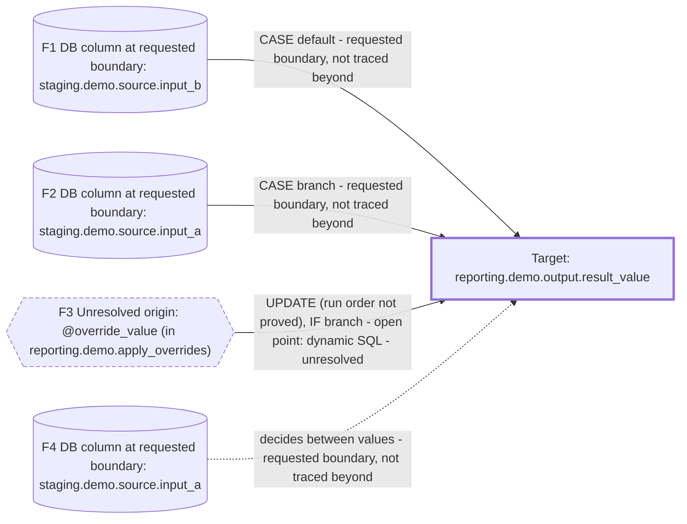

# Column overview: `reporting.demo.output.result_value`

## Field and definition

- **Field:** `reporting.demo.output.result_value` — database `reporting`, schema `demo`, table `output`, column `result_value`
- **Definition not approved.** No glossary entry; the tool never infers business meaning from names — question for the data owner.

## Plain answer

- **Not fully traced (1 open point on the value routes, so sources may be missing).** Also: 1 route stops at an open point.
- **Sources:**
    - `staging.demo` (CASE branch, CASE default; [F1](sample-trace.md#fam-7ff0de8a8f), [F2](sample-trace.md#fam-c93c713b4c))
    - variables (UPDATE of unproved run order; [F3](sample-trace.md#fam-fcaa68cfb4))
- **Value rules:** a CASE/IIF choice picks between the alternatives; an UPDATE may overwrite the value (run order not proved) — details under What changes the value.

## Coverage

- **Status:** **Incomplete** — 1 open point on the value routes ([gaps](sample-trace.md#gaps)); proof stops before an origin on the routes they touch. 2 ends do reach the requested boundary, but the trace as a whole is not complete.
- **Coverage:** 4 routes (3 carry the value, 1 decides between values) in 4 route families · distinct end points (columns where routes stop): 2 at the requested boundary · 0 declared terminals · 1 unresolved origin (1 open point) · steps: 2 verified, 0 inferred, 0 asserted, 1 partial.
- A requested boundary or declared terminal is where this run stopped; it is not an originating system. An end with no writer in the selected sources is an unresolved origin even when the step reaching it is verified.

## Main evidence needed

- **SQL built and run at run time (dynamic SQL)** (1 place, 1 route affected): the SQL this statement builds and executes at runtime (a captured example or a confirmed mapping), or the metadata that drives it — [details](sample-trace.md#gap-2ff3f09fbe22902d)

## Route families

Each box is a route family (routes with the same source family, value rule, stopping reason and evidence status); each has its own arrow into the field, so alternatives are side by side, not in sequence. Dotted arrows decide between values. Box and edge labels say where proof stops — no box is claimed as the originating system.

| Family | Source | Value rule | Stops because | Evidence | Routes |
|---|---|---|---|---|---|
| [F1](sample-trace.md#fam-7ff0de8a8f) | DB: `staging.demo.source.input_b` | CASE default | requested boundary, not traced beyond | verified (proved from code) | 1 |
| [F2](sample-trace.md#fam-c93c713b4c) | DB: `staging.demo.source.input_a` | CASE branch | requested boundary, not traced beyond | verified (proved from code) | 1 |
| [F3](sample-trace.md#fam-fcaa68cfb4) | variable: `@override_value (in reporting.demo.apply_overrides)` | UPDATE (run order not proved), IF branch | open point: dynamic SQL | unresolved (not proved) | 1 |
| [F4](sample-trace.md#fam-418ab2a211) | DB: `staging.demo.source.input_a` | decides between values | requested boundary, not traced beyond | verified (proved from code) | 1 |

## Sources at a glance

One row per end point. Files, constants and variables are labelled in the first column and never shown as databases.

| Kind | Database | Schema | Table / source | Column | Family | Why it stops | Proof of the step reaching it |
|---|---|---|---|---|---|---|---|
| DB column | `staging` | `demo` | `source` | `input_b` | [F1](sample-trace.md#fam-7ff0de8a8f) | requested boundary reached (the run was asked to stop here; not traced beyond) | verified (proved from code) ([S3](sample-trace.md#step-9fa99888e121e84d)) |
| DB column | `staging` | `demo` | `source` | `input_a` | [F2](sample-trace.md#fam-c93c713b4c), [F4](sample-trace.md#fam-418ab2a211) | requested boundary reached (the run was asked to stop here; not traced beyond) (value, and decides between values) | verified (proved from code) ([S3](sample-trace.md#step-9fa99888e121e84d)) |
| variable | — | — | `@override_value (in reporting.demo.apply_overrides)` | — | [F3](sample-trace.md#fam-fcaa68cfb4) | open point: SQL built and run at run time (dynamic SQL) — not proved | unresolved ([S2](sample-trace.md#step-a92b7a4a25e85778)) |

## What changes the value

- **CASE/IIF choice** in `reporting.demo.load_output` writing `#work.chosen_value (in reporting.demo.load_output)`: 1 condition on `staging.demo.source.input_a` decides between `staging.demo.source.input_a`, `staging.demo.source.input_b` — [S3](sample-trace.md#step-9fa99888e121e84d)
- **Override** by UPDATE in `reporting.demo.apply_overrides`: replaces `reporting.demo.output.result_value` for the rows it matches with `@override_value (in reporting.demo.apply_override…` (run order relative to the other writers is not proved) — [S2](sample-trace.md#step-a92b7a4a25e85778)

## Which rows?

These conditions decide **which rows** are included; they do not compute the value. 3 conditions on 2 objects:

- `staging.demo.source`: join key `s.id = k.id`; filter `s.is_active = 1`
- `staging.demo.lookup_key`: join key `s.id = k.id`

## Evidence and uncertainty

- **Steps on the value routes:** 3 — **2 verified**, **0 inferred**, **0 asserted**, 1 partial. Verified = proved from explicit code. Partial = some inputs of the step are not proved.
- **Not proved from code:** partial [S2](sample-trace.md#step-a92b7a4a25e85778) — never read these as code-proved.
- **Assertions:** none used; nothing here rests on an asserted mapping.
- **Open points:** 1 on the value, 0 of context, 0 on row selection only (which rows, not the value) — [gaps and next evidence](sample-trace.md#gaps).
- **Source locations:** `procedures/load_output.sql` (2 steps, lines 5–14), `procedures/apply_overrides.sql` (1 step, line 12) — every step's location and excerpt is on the [detailed page](sample-trace.md#detailed-steps).

## Routes: how the value arrives

2 object routes: each is the sequence of objects the value passes, from this field back to where the trace ended (← reads "comes from"); branch labels are listed, not combined. Exact expressions are on the [detailed page](sample-trace.md#value-lineage).

**Route 1** (2 ends: 2 boundary reached): `reporting.demo.output` ← `#work (temp table in reporting.demo.load_output)` ← `staging.demo.source`
- Branches on the way: `writer reporting.demo.load_output`
- Ends: `staging.demo.source.input_a` (value, and decides between values; via `WHEN s.input_a IS NOT NULL`, `WHEN s.input_a IS NOT NULL THEN`); `staging.demo.source.input_b` (via `ELSE`)
- Proof: 2 verified (proved from code); written by `procedure reporting.demo.load_output`

**Route 2** (1 end: 1 open point): `reporting.demo.output`
- Branches on the way: `IF @apply_override = 1`; `writer reporting.demo.apply_overrides`
- Ends: `@override_value (in reporting.demo.apply_overrides)`
- Proof: 1 partial (some inputs not proved); written by `procedure reporting.demo.apply_overrides`; open points: SQL built and run at run time (dynamic SQL)

## Open points

- **SQL built and run at run time (dynamic SQL)** (1 place, affects value): [`@override_value (in reporting.demo.apply_overrides)`](sample-trace.md#gap-2ff3f09fbe22902d)

## Links

- Detailed page: [sample-trace.md](sample-trace.md) — [short answer](sample-trace.md#short-answer), [value tree](sample-trace.md#value-lineage), [route families](sample-trace.md#route-families), [row selection](sample-trace.md#row-selection), [steps and evidence](sample-trace.md#detailed-steps), [gaps and next evidence](sample-trace.md#gaps)
- Full trace (source of truth): [sample-trace.lineage.json](sample-trace.lineage.json) — route families with every member route are in its `route_families` block
