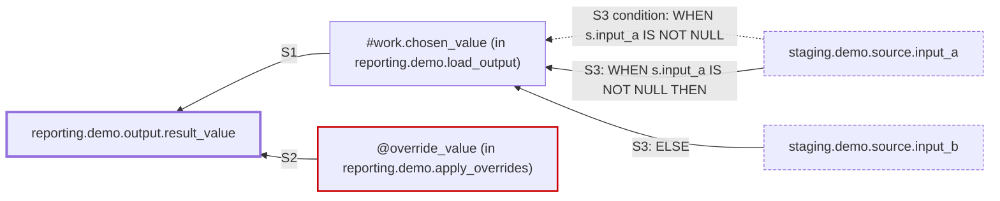

# Column lineage: `reporting.demo.output.result_value`

<a id="identity"></a>

## 1. Identity and result

> **Result: Incomplete — 1 value-path gap** (overall step status: partial)
>
> A *stop* at the requested boundary, or at a source with no writer in the scanned files, is where this trace ended. It is not a claim that those columns are ultimate source-system fields.

| Field | Value |
|---|---|
| Target | `reporting.demo.output.result_value` (id `reporting.demo.output.result_value`, column) |
| Requested | `reporting.demo.output.result_value` |
| Target resolution | verified |
| Scan scope | `sql`; 3 files, 14 statements, 13 parsed, 1 parse fallbacks |
| Requested boundary | databases `staging` |
| Source revision | `synthetic-r1` |
| Trace schema | `column-lineage/1.0` |
| Steps | 3 (verified: 2, partial: 1) |
| Stops | boundary: 2 |
| Gaps | dynamic_sql: 1 |
| Companion JSON | [sample-trace.lineage.json](sample-trace.lineage.json) |

*Complete means every value path ends at the requested boundary or at a source object with no writer in the selected scanned sources, with no value-path or context gaps. result says which: reached_requested_boundary, complete_to_declared_boundary (every other end is a terminal declared for this run; their original stop reasons are kept and upstream population beyond them is not proved), or complete_within_selected_scope when some paths end at objects with no writer in the selected sources (not proof that they are ultimate sources). Where a write reads the value its column or variable already had, that read ends at an 'earlier content' node (stop prior_state): the value before that write, with its candidate earlier writers traced (which of them populated the rows is not proved). Row-selection gaps (filters and joins that could not be fully resolved) are reported separately and do not make the value lineage incomplete. A complete trace does not claim its stops are ultimate source-system fields.*

<a id="short-answer"></a>

## 2. Short answer

- **Value comes from:** `staging.demo.source.input_a` and `staging.demo.source.input_b` (requested boundary).
- **Value paths without proof:** `@override_value (in reporting.demo.apply_overrides)` (⚠ dynamic_sql).
- **Route:** 3 value steps through `#work.chosen_value (in reporting.demo.load_output)`; 1 rename ([S1](#step-a8a5acba10b98843)).
- **Conditions:** [S3](#step-9fa99888e121e84d) (`#work.chosen_value (in reporting.demo.load_output)`, case) has 2 value alternatives: `WHEN s.input_a IS NOT NULL THEN` → `staging.demo.source.input_a`; `ELSE` → `staging.demo.source.input_b`; chosen by `WHEN s.input_a IS NOT NULL` (reads `staging.demo.source.input_a`).
- **Alternative writers:** `reporting.demo.output.result_value` has 2 alternative writers: [S1](#step-a8a5acba10b98843) insert_select in reporting.demo.load_output and [S2](#step-a92b7a4a25e85778) update in reporting.demo.apply_overrides under IF @apply_override = 1. All are kept as alternatives.
- **Row selection:** 3 row-selection columns (filter (WHERE): 1, join key: 2) decide which rows contribute; they are not value sources (see [Row-selection context](#row-selection)).
- **Where the trace stops:** requested boundary. This is where the trace ended, not a claim about ultimate source-system fields.
- **Uncertainty:** 1 value-path gap (dynamic_sql: 1) — see [Gaps and next evidence](#gaps); 1 step partial ([S2](#step-a92b7a4a25e85778)).

<a id="value-lineage"></a>

## 3. Value lineage overview

Read upward from the target: each `S<n>` line is a mapping step (writer, operation, status, branch) and the lines under it are its inputs. `[value · …]` inputs compute the value; `[condition · …]` inputs choose between value alternatives. `■ stop` marks where the trace ended; `⚠ gap` marks where proof is missing. Row-selection columns are not shown here.

```text
reporting.demo.output.result_value  ◀ target
├─ writer 1 of 2: S1 insert_select in reporting.demo.load_output · rename · verified
│  └─ [value] #work.chosen_value (in reporting.demo.load_output)
│     └─ S3 select_into in reporting.demo.load_output · case · verified
│        ├─ [condition · WHEN s.input_a IS NOT NULL] staging.demo.source.input_a  ■ stop: boundary
│        ├─ [value · WHEN s.input_a IS NOT NULL THEN] staging.demo.source.input_a  ■ stop: boundary
│        └─ [value · ELSE] staging.demo.source.input_b  ■ stop: boundary
└─ writer 2 of 2: S2 update in reporting.demo.apply_overrides · direct · partial · branch: IF @apply_override = 1  ⚠ gap: dynamic_sql
   └─ [value] @override_value (in reporting.demo.apply_overrides)  ⚠ gap: dynamic_sql  (unresolved)
```

<details><summary>Diagram (Mermaid)</summary>



</details>

<a id="source-columns"></a>

### Source columns

Every named column where value routes end, once however many routes reach it. A requested boundary or declared terminal is where the run stopped; an unresolved origin is where no writer, producer or caller was found. *Last step* is the status of the steps that read the column; *whole route* is the worst link on the way from the field (an asserted or inferred step anywhere on it counts).

| Column | How its routes end | Routes | Last step | Whole route | Role |
|---|---|---|---|---|---|
| `staging.demo.source.input_a` | **Requested boundary reached** | 2 | verified | verified | value |
| `staging.demo.source.input_b` | **Requested boundary reached** | 1 | verified | verified | value |

<a id="route-families"></a>

### Route families

4 families, 4 value routes. A family groups routes with the same source family, value rule, stopping reason and evidence status; alternatives with different logic, confidence or stopping reason are separate families. Ends are where the trace stopped, not confirmed origins.

- <a id="fam-c93c713b4c"></a>**F1** `fam-c93c713b4c` — source staging.demo; value rule: CASE branch; stops: requested boundary, not traced beyond; evidence: verified (proved from code); 1 route
  - `staging.demo.source.input_a` — steps [S1](#step-a8a5acba10b98843), [S3](#step-9fa99888e121e84d) — branches `WHEN s.input_a IS NOT NULL THEN`
- <a id="fam-7ff0de8a8f"></a>**F2** `fam-7ff0de8a8f` — source staging.demo; value rule: CASE default; stops: requested boundary, not traced beyond; evidence: verified (proved from code); 1 route
  - `staging.demo.source.input_b` — steps [S1](#step-a8a5acba10b98843), [S3](#step-9fa99888e121e84d) — branches `ELSE`
- <a id="fam-ac0ad92d7a"></a>**F3** `fam-ac0ad92d7a` — source variables; value rule: override (later UPDATE), IF branch; stops: open point: dynamic SQL; evidence: unresolved (not proved); 1 route
  - `@override_value (in reporting.demo.apply_overrides)` — steps [S2](#step-a92b7a4a25e85778) — branches `IF @apply_override = 1` — open points [dynamic_sql](#gap-2ff3f09fbe22902d)
- <a id="fam-418ab2a211"></a>**F4** `fam-418ab2a211` — source staging.demo; value rule: decides between values; stops: requested boundary, not traced beyond; evidence: verified (proved from code); 1 route
  - `staging.demo.source.input_a` — steps [S1](#step-a8a5acba10b98843), [S3](#step-9fa99888e121e84d) — branches `WHEN s.input_a IS NOT NULL`

<a id="row-selection"></a>

## 4. Row-selection context

These columns decide **which rows** reach each step (filters, join keys, grouping). They do not compute the value and are listed separately from value inputs. They are not traced upstream unless the trace was run with `--trace-row-selection`.

**[S3](#step-9fa99888e121e84d)** — rows feeding `#work.chosen_value (in reporting.demo.load_output)` (select_into in reporting.demo.load_output)

| Role | Column | Predicate | Status | Evidence |
|---|---|---|---|---|
| filter (WHERE) | `staging.demo.source.is_active` | `s.is_active = 1` | verified | `procedures/load_output.sql:11` |
| join key | `staging.demo.lookup_key.id` | `s.id = k.id` | verified | `procedures/load_output.sql:10` |
| join key | `staging.demo.source.id` | `s.id = k.id` | verified | `procedures/load_output.sql:10` |

<a id="detailed-steps"></a>

## 5. Detailed steps

Ordered target-first, then upstream by depth.

<a id="step-a8a5acba10b98843"></a>

### S1. `reporting.demo.output.result_value` ← `chosen_value`

- **Target:** `reporting.demo.output.result_value` (id `reporting.demo.output.result_value`)
- **Expression:** `chosen_value`
- **Writer:** insert_select in `reporting.demo.load_output`
- **Mapping method:** target_list
- **Operation:** rename
- **Branch context:** none (unconditional)
- **Status:** **verified**
- **Depth:** 0
- **Alternative writers:** [S2](#step-a92b7a4a25e85778)
- **Evidence:**
  - `procedures/load_output.sql:14-16` `INSERT INTO reporting.demo.output (id, result_value) SELECT id, chosen_value FROM #work` (statement)

| # | Input | Role | Branch | As written | Status |
|---|---|---|---|---|---|
| 1 | `#work.chosen_value (in reporting.demo.load_output)` → [S3](#step-9fa99888e121e84d) | value | — | `chosen_value` | verified |

<a id="step-a92b7a4a25e85778"></a>

### S2. `reporting.demo.output.result_value` ← `@override_value`

- **Target:** `reporting.demo.output.result_value` (id `reporting.demo.output.result_value`)
- **Expression:** `@override_value`
- **Writer:** update in `reporting.demo.apply_overrides`
- **Mapping method:** set_clause
- **Operation:** direct
- **Branch context:** `IF @apply_override = 1`
- **Status:** **partial**
- **Depth:** 0
- **Alternative writers:** [S1](#step-a8a5acba10b98843)
- **Gaps:** ⚠ [dynamic_sql](#gap-2ff3f09fbe22902d)
- **Evidence:**
  - `procedures/apply_overrides.sql:12` `UPDATE reporting.demo.output SET result_value = @override_value WHERE id = @id` (statement)

| # | Input | Role | Branch | As written | Status |
|---|---|---|---|---|---|
| 1 | `@override_value (in reporting.demo.apply_overrides)` | value | — | `@override_value` | unresolved ⚠ [dynamic_sql](#gap-2ff3f09fbe22902d) |

<a id="step-9fa99888e121e84d"></a>

### S3. `#work.chosen_value (in reporting.demo.load_output)` ← `CASE WHEN s.input_a IS NOT NULL THEN s.input_a ELSE s.input_b END`

- **Target:** `#work.chosen_value (in reporting.demo.load_output)` (id `temp_table:procedures/load_output.sql::reporting.demo.load_output::#work.chosen_value`)
- **Expression:** `CASE WHEN s.input_a IS NOT NULL THEN s.input_a ELSE s.input_b END`
- **Writer:** select_into in `reporting.demo.load_output`
- **Mapping method:** projection_alias
- **Operation:** case
- **Branch context:** none (unconditional)
- **Status:** **verified**
- **Depth:** 1
- **Row selection:** 3 items — see [Row-selection context](#row-selection)
- **Evidence:**
  - `procedures/load_output.sql:3-11` `SELECT s.id, CASE ... END AS chosen_value INTO #work FROM staging.demo.source AS s JOIN ... WHERE ...` (statement)
  - `procedures/load_output.sql:5` `CASE WHEN s.input_a IS NOT NULL THEN s.input_a ELSE s.input_b END AS chosen_value` (expression)

| # | Input | Role | Branch | As written | Status |
|---|---|---|---|---|---|
| 1 | `staging.demo.source.input_a` | condition | `WHEN s.input_a IS NOT NULL` | `s.input_a` | verified ■ boundary |
| 2 | `staging.demo.source.input_a` | value | `WHEN s.input_a IS NOT NULL THEN` | `s.input_a` | verified ■ boundary |
| 3 | `staging.demo.source.input_b` | value | `ELSE` | `s.input_b` | verified ■ boundary |

<a id="gaps"></a>

## 6. Gaps and next evidence

### dynamic_sql (1)

- <a id="gap-2ff3f09fbe22902d"></a>**@override_value is assigned by dynamic SQL (EXEC sp_executesql); its source columns cannot be established statically.**
  - Node: `@override_value (in reporting.demo.apply_overrides)` (id `variable:procedures/apply_overrides.sql::reporting.demo.apply_overrides::@override_value`)
  - Affects: [S2](#step-a92b7a4a25e85778)
  - Evidence: `procedures/apply_overrides.sql:9` `EXEC sp_executesql @sql, N'@v int OUTPUT', @v = @override_value OUTPUT;`
  - statement_keyword: `EXEC`
  - variable: `@override_value`

### Steps that are not verified

- [S2](#step-a92b7a4a25e85778) `reporting.demo.output.result_value` — **partial** (update in reporting.demo.apply_overrides under IF @apply_override = 1)

<a id="where-proof-ends"></a>

### Where proof ends

- Stopped — requested boundary:
  - `staging.demo.source.input_a` (database staging is in the requested boundary)
    - Reached via [S3](#step-9fa99888e121e84d) at `procedures/load_output.sql:5` — branch `WHEN s.input_a IS NOT NULL`, `WHEN s.input_a IS NOT NULL THEN`
  - `staging.demo.source.input_b` (database staging is in the requested boundary)
    - Reached via [S3](#step-9fa99888e121e84d) at `procedures/load_output.sql:5` — branch `ELSE`
- Proof is missing at:
  - `@override_value (in reporting.demo.apply_overrides)` — dynamic_sql (value path)
    - Where: `procedures/apply_overrides.sql:9`
    - Reached via [S2](#step-a92b7a4a25e85778) at `procedures/apply_overrides.sql:12`
    - Next evidence (dynamic_sql): the SQL this statement builds and executes at runtime (a captured example or a confirmed mapping), or the metadata that drives it
- Weaker links on the value paths (not ends, but not verified): 1 step
  - partial — set_clause: [S2](#step-a92b7a4a25e85778)

Proof ends at the 1 node listed above with gaps; value paths through them are unproven. The result is **Incomplete — 1 value-path gap**. Stops mark where the trace ended, not ultimate source-system fields.

Companion JSON (complete trace graph and full evidence): [sample-trace.lineage.json](sample-trace.lineage.json)
