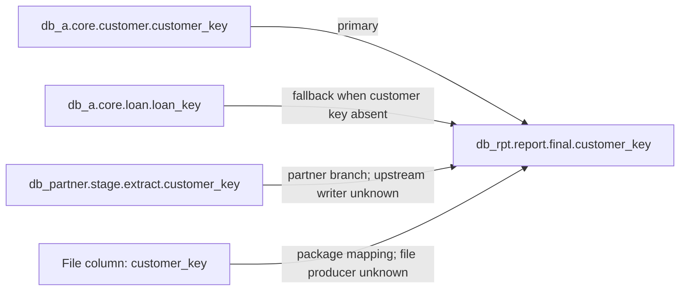

# Column lineage presentation brief for the external implementer

This brief uses invented names. It can be shared with an implementer who cannot see the real sources. Keep the existing detailed Markdown and JSON output; improve the short overview and run-level index.

## Short overview: one page per column

Make the first screen useful without scrolling through every path:

- **Field and definition:** fully qualified target column; an approved glossary definition if supplied. Otherwise say **“Definition not approved”** and, if useful, show a separately labelled *proposed interpretation* with its provenance.
- **Plain answer:** one or two sentences about the main source families and any fallback or override that materially changes the value.
- **Coverage:** a small line with the number of value routes, endpoints at a chosen boundary, unresolved origins, and verified/inferred/asserted steps. Spell out that a selected boundary or terminal is not an originating system.
- **Main evidence needed:** at most three bullets, prioritised by how many routes or columns they affect.
- **Diagram:** a Mermaid flowchart of **route families**, not every SQL statement. Show alternative branches separately. Use different labels for database columns, file columns, constants, and unresolved origins. Keep it small enough to read in GitHub Markdown; link each family to the detailed page.
- **Sources at a glance:** a compact table with database, schema, table, column, route family and stopping reason. File connections and constants belong in separate rows. Do not call a file connection a database.
- **What changes the value:** bullets for meaningful CASE choices, fallbacks, merges, overrides or aggregations. Put row filters under a separate “Which rows?” heading; do not confuse a condition with a value source.
- **Evidence and uncertainty:** prominently distinguish verified, inferred and asserted. Link to the exact technical steps, assertion record and source location. A missing writer is an unresolved origin even when the final step reaching the table is verified.

For example, an invented diagram could be:

Prefer short bullets and tables. If a column has dozens of routes, group them by **same source family and same value rule**; show route counts and a link to the complete list. Never merge alternatives with different value logic, confidence or stopping reason. Do not dump hundreds of row-selection predicates onto the business page.

## Detailed page and JSON

- Preserve every value contributor and CASE/IF/ELSE alternative, including constants and fallback paths.
- Preserve row-selection and branch conditions separately from value lineage.
- Preserve source file and line, short excerpt, step status, assertion source, endpoint reason, and all gaps.
- Use stable IDs so an overview diagram or table row links to the corresponding detailed steps.
- Keep the JSON as the canonical machine-readable graph. Add fields if necessary for route-family grouping; do not discard nodes or evidence to simplify the overview.

## Run-level index

- Group columns by shared terminal-source signatures and by writer signatures.
- Show group size and link to each column overview. Explain that shared route does **not** mean shared transformation or business definition.
- Provide a concise “needs attention” view: unresolved origins, high-impact ambiguous writer order, assertions awaiting review, and definitions awaiting owner approval.

## Acceptance checks

- A reader can answer “What feeds this field, where does proof stop, and what is assumed?” from the first screen.
- A person can distinguish source **database, schema, table and column** wherever the evidence establishes them.
- The diagram does not imply that alternatives happen sequentially or that a declared terminal is the true origin.
- An incomplete trace remains visibly incomplete, even if some branches reach the requested boundary.
- Every overview claim can be checked through a link to the detailed page or glossary entry.
